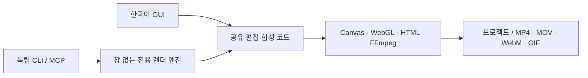
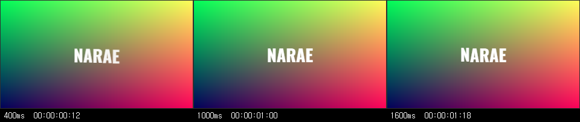

<p align="center"></p>

# 나래 무비메이커 · Narae Movie Maker

**기획·제작: [@y5496694](https://github.com/y5496694)**

한국어 데스크톱 영상 편집기와 **GUI 설치·실행 없이 영상을 만들고 편집하는 독립 CLI**입니다. CLI용 렌더 엔진을 포함해 CartCut이나 별도 Node.js 설치도 필요하지 않습니다.

CartCut v0.6.1의 MIT 소스를 기반으로 나래 브랜딩, 한국어 기본 화면, 독립 렌더 엔진, CLI와 MCP 연결을 구현했습니다. 원본 편집·합성 코드를 공유하며 마우스·키보드 자동 조작을 사용하지 않습니다.

## 다운로드

[v1.0.0 릴리스](https://github.com/y5496694/narae-movie-maker/releases/tag/v1.0.0)에서 받으세요. 현재 실행 배포본은 **Windows x64**용입니다.

| 파일 | 용도 |
| --- | --- |
| `NaraeMovieMaker-Desktop-1.0.0-win-x64.zip` | 한국어 GUI와 CLI 전체 배포본 |
| `NaraeMovieMaker-CLI-1.0.0-win-x64.zip` | GUI 실행 파일이 없는 독립 CLI 배포본 |
| `NaraeMovieMaker-1.0.0-source.zip` | 전체 소스, 빌드 안내와 감사 자료 |
| `NaraeMovieMaker-SHA256.txt` | 배포 파일 SHA-256 체크섬 |

압축을 모두 풀고 `runtime` 폴더를 함께 보관하세요. Desktop은 `나래 무비메이커.cmd`, 독립 CLI는 `narae.cmd`로 실행합니다.

## CLI 빠른 시작

CLI 배포본 폴더에서 PowerShell을 열어 실행합니다.

```powershell
.\narae.cmd doctor
.\narae.cmd new demo.nmm --width 1080 --height 1920 --fps 30 --seconds 5
.\narae.cmd title demo.nmm "나래 무비메이커" --start 0 --seconds 5 --font-size 72
.\narae.cmd render demo.nmm demo.mp4
.\narae.cmd inspect demo.nmm
```

기존 파일을 덮어쓸 때에는 `--overwrite`를 명시합니다. `.nmm`과 기존 `.ngt` 프로젝트를 열 수 있습니다. 원본 미디어는 프로젝트와 함께 보관하세요.

```powershell
.\narae.cmd add demo.nmm "C:\영상\소스.mp4" --start 0
.\narae.cmd tools --names
.\narae.cmd tools --describe trim_clip
.\narae.cmd edit demo.nmm trim_clip @trim.json
.\narae.cmd run examples\간단한_숏츠.json --result result.json
.\narae.cmd render demo.nmm demo.webm
```

일반 CLI의 `--start`, `--seconds`는 **초**, 도구 JSON의 `startMs`, `durationMs`는 **밀리초**입니다. 레시피의 `{"$ref":"media.created.0"}`으로 앞 단계 결과를 참조할 수 있습니다. [한국어 사용설명서](docs/사용설명서.txt)와 [108개 도구 스키마](docs/cli-tool-schemas.json)에 호출 형식을 정리했습니다.

## 편집 기능

원본 추적 소스 **2,383개 경로**와 기존 편집 도구·메뉴·프리셋 식별자를 보존했습니다.

| 영역 | 기능 |
| --- | --- |
| 타임라인 | 배치, 자르기·분할·병합, 복제, 이동, 트랙, 그룹, 실행 취소·다시 실행 |
| 영상·음성 | 속도·속도 곡선, 역재생, 음성 분리, 프록시, 회전·크롭·미러 |
| 텍스트·자막 | 한글 제목, 글꼴·서식, 자막 배치, 자막 파일 입출력 |
| 합성 | 색상 조정, LUT, 마스크, 도형, 장식, 키프레임, 효과·전환 |
| 그래픽 | GLSL, HTML 그래픽, 프리셋, 합성된 연락 시트 |
| 재사용 | 템플릿 입출력, 구성 전환, 텍스트·미디어 교체 슬롯 |
| 출력 | MP4, MOV, WebM, GIF와 GUI와 동일한 출력 설정 정규화 |
| 확장 | 원본 확장 기능과 기여된 명령 조회·실행 |
| 독립 녹화 | 화면·카메라·마이크, 장치 조회, 유한 길이 녹화, 취소, dry run |

원본 프리셋 **효과 39개·전환 37개·그래픽 28개·LUT 80개**도 보존했습니다. [기능 대조표](docs/audit/기능대조표.txt)에 소스와 호출 경로가 있습니다.

### 녹화

```powershell
.\narae.cmd devices
.\narae.cmd record-screen screen.mp4 --seconds 10 --fps 30
.\narae.cmd record-screen region.mp4 --seconds 10 --region 0,0,1080,1920 --dry-run
.\narae.cmd record-camera camera.mp4 --seconds 10 --video-device "장치 이름"
.\narae.cmd record-audio voice.wav --seconds 10 --audio-device "마이크 이름"
```

마이크 장치를 명시한 경우에만 마이크를 사용합니다. `--dry-run`은 녹화 없이 명령을 확인하며, `Ctrl+C`는 해당 녹화만 중단합니다.

## MCP 연결

독립 MCP 서버는 표준 입출력으로 동작합니다.

```powershell
.\narae.cmd mcp
```

- `narae_describe_tools`: 실제 엔진 도구의 설명과 JSON 스키마를 조회합니다.
- `narae_run_job`: 레시피로 108개 편집 도구를 실행하고 저장·출력합니다.

Codex에 연결하려면 CLI 배포본 폴더에서 실행합니다.

```powershell
$root = (Resolve-Path .).Path
codex mcp add narae --env ELECTRON_RUN_AS_NODE=1 -- "$root\runtime\narae-engine.exe" "$root\cli\narae.mjs" mcp
```

긴 영상은 Codex 설정의 `[mcp_servers.narae]`에 `tool_timeout_sec = 3700`을 설정하세요. GUI 내부 MCP는 별도로 `127.0.0.1:9827`에서 제공됩니다. 독립 CLI는 이 HTTP 서버에 의존하지 않습니다.



## 실제 검증 범위

| 확인 항목 | 결과 |
| --- | --- |
| 실제 CLI 시나리오 | 6개, 64종 도구의 93단계 통과 |
| 출력 | MP4/MOV/WebM/GIF 전체 프레임 디코딩 통과 |
| 음성 | 출력된 실제 PCM 신호 확인, MOV/WebM 음성 포함 |
| 그래픽 | HTML·GLSL 합성, 연락 시트, 창 없는 엔진 출력 확인 |
| 독립 배포 | GUI 실행 파일 없음, 시스템 Node.js 경로 제외, MCP 생성·저장·재열기·렌더링 통과 |
| 전체 테스트 | 11,151개 중 11,116 통과, 기존 플랫폼 관련 실패 27개, 건너뜀 8개 |
| 추가 CLI 테스트 | 녹화 명령 구성·취소 계약, MCP 표준 입출력 등 13개 통과 |

모든 108개 도구와 모든 외부 환경을 실행 검증한 것은 아닙니다. 남은 27개 실패는 원본 기준에서도 발생한 Windows 경로·글꼴·픽셀 스냅샷·줄바꿈·심볼릭 링크 등의 항목이며 새로 도입된 실패는 없습니다. [검증 요약](docs/audit/tests-final-summary.json), [실제 CLI 결과](docs/audit/tests-runtime-final.json), [출력 형식 검증](docs/audit/tests-export-formats.json)을 참고하세요.

CLI로 실제 출력한 한글 영상 프레임과 HTML/GLSL 합성 결과입니다.




### 외부 기능과 운영체제 조건

로컬 TTS는 Supertonic-3 모델을 처음 사용할 때 다운로드합니다. STT는 선택한 Whisper 서버·OpenAI 키 또는 지원되는 Apple 런타임이 필요합니다. AI 배경 제거·클라우드·확장은 원본의 모델·네트워크·계정 조건을 따릅니다. 실제 카메라·마이크 녹화, 모든 AI 제공자, 하드웨어 인코더, Apple 전용 기능은 이번 Windows 배포에서 전부 실행 검증하지 않았습니다.

Linux/macOS 소스도 보존했지만 현재 실행 배포본은 Windows x64용입니다. 자동 업데이트 서비스는 기본 비활성화입니다.

## 소스 빌드

Node.js 24+, npm과 해당 플랫폼의 FFmpeg/FFprobe가 필요합니다.

```powershell
npm ci
# 배포본 runtime/resources/bin의 ffmpeg.exe, ffprobe.exe를 bin/win32-x64에 배치
npm run build:main
npm run bundle:prod:src
npm run build:overlay
node node_modules/electron-builder/cli.js --win --x64 --dir --publish never
```

개발 중에는 `node cli/narae.mjs --help`, `node cli/narae.mjs mcp`로 실행합니다. [빌드 안내](NARAE-BUILD.txt)를 참고하세요. 원본 배포 워크플로는 출처 보존을 위해 남겼으며 이 저장소의 자동 Actions 실행은 초기 배포에서 비활성화했습니다.

## 제작과 출처

- **나래 무비메이커 기획·제작: @y5496694**
- 기반: [CartCut](https://github.com/cartesiancs/cartcut) v0.6.1, 원본 저작권 `Copyright (c) 2025 cartesiancs`
- 기반 커밋: `55c424e358a77282ff50b3b3ade31e7cbc3cb8b1`
- 분석: [REA](https://github.com/morluto/rea) 6.8.0과 소스 대조. 구문 실패 21개·부분 그래프 한계는 [증거 요약](docs/audit/rea-evidence-summary.json)에 명시했습니다.
- [원본 README](docs/upstream-README.md), [MIT LICENSE](LICENSE), [NOTICE](NOTICE.txt)를 함께 제공합니다. 제삼자 구성 요소는 각자의 라이선스를 따릅니다.
